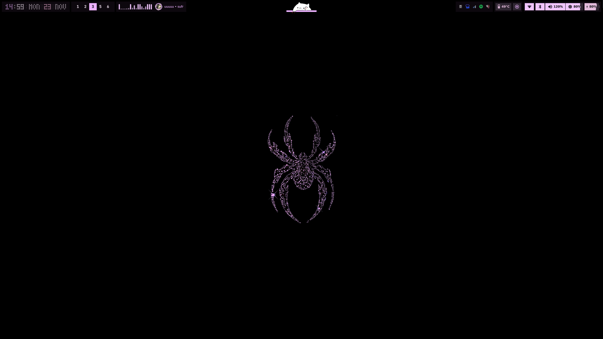
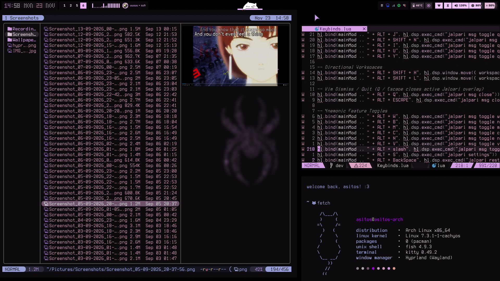

# dotfiles

my personal setup for arch linux + hyprland. i like keeping things fast, minimal, and out of the way so i can focus on writing code.

feel free to steal anything you like, but please don't blindly copy-paste my scripts unless you know what they do to your system :p

---

### the rice

> a quick look at the desktop environment.

<div align="center">
  

  
  <p><i>clean workspace</i></p>

  <br />
<video src="https://github.com/user-attachments/assets/6f51543a-dd0c-4825-abfe-d04ac9527473" width="100%" controls></video>
  <p><i>hyprland animations and workflow</i></p>
</div>

> wallpaper can be found [here](https://github.com/user-attachments/assets/1c7ea0be-eb52-4327-9eea-1d4f35d7b180)

---

### things used

- **os:** arch linux
- **wm:** hyprland
- **terminal:** kitty
- **bar / shell:** [quickshell](https://outfoxxed.me/quickshell) (jalpari)
- **shell:** fish
- **notifs:** quickshell / mako
- **clipboard:** clipse
- **editor:** [neovim](https://github.com/asitos/neovim-dotfiles)
- **launcher:** tofi
- **file manager:** yazi

---

### installation

there are two ways to install these dotfiles:

#### 1. automated symlink (install script)
runs [`install.sh`](./install.sh) to check dependencies and idempotently symlink configs into `~/.config/` and CLI binaries into `~/.local/bin/`. existing configurations are safely backed up with timestamps:

```bash
git clone https://github.com/asitos/dotfiles.git
cd dotfiles
chmod +x install.sh

# check dependencies & symlink configs:
./install.sh

# or auto-install missing packages on Arch:
./install.sh -i

# check-only without making changes:
./install.sh -c
```

#### 2. manual (copy & paste)
if you don't want symlinks and just want specific configs, clone the repo and copy whichever folders you need directly into `~/.config/`:

```bash
git clone https://github.com/asitos/dotfiles.git
cd dotfiles

# copy individual tool:
cp -r config/<tool> ~/.config/

# or copy all configs:
cp -r config/* ~/.config/
```

> **neovim:** neovim config is maintained in its own repository at [asitos/neovim-dotfiles](https://github.com/asitos/neovim-dotfiles):
> ```bash
> # backup existing config if present
> [ -d ~/.config/nvim ] && mv ~/.config/nvim ~/.config/nvim.bak.$(date +%Y%m%d%H%M%S)
>
> # clone directly into ~/.config/nvim
> git clone https://github.com/asitos/neovim-dotfiles.git ~/.config/nvim
> ```

---

### uninstall

to remove the dotfiles symlinks and automatically restore your original configurations from backup:

```bash
## go to wherever you cloned this repo, for example:
cd ~/dotfiles
chmod +x uninstall.sh
./uninstall.sh
```

---

### jalpari syntax

`jalpari` manages the quickshell daemon, ui overlays, audio/display controls, and themes:

```bash
# daemon management
jalpari daemon reload                       # reload quickshell config
jalpari daemon restart                      # restart daemon
jalpari daemon stop                         # stop daemon
jalpari daemon status                       # check daemon status

# ui panels & overlays
jalpari ui toggle <panel>                   # wallpaper, network, volume, calendar, music, quickactions
jalpari ui open <panel>                     # open specific panel
jalpari ui close                            # close active overlay
jalpari ui bar <autohide|show|hide>         # toggle/set bar visibility

# audio & display
jalpari audio volume raise|lower            # adjust volume (±5%)
jalpari audio mute                          # toggle output mute
jalpari audio mic toggle                    # toggle mic mute
jalpari display brightness set <0-100>      # set brightness level
jalpari display gamma <set|auto|reset>      # blue light / night light temperature

# theming & configuration
jalpari theme preset [name]                 # apply/list color preset
jalpari theme wallpaper <path|next|prev>    # change wallpaper
jalpari theme reload                        # reload theme colors
jalpari config gui                          # open quickshell settings gui
jalpari config get <key>                    # read config value
jalpari config set <key> <val>              # write config value
```

---

### arch linux full bootstrap (ansible)
for provisioning a fresh arch linux workstation (installs all system packages via pacman and sets up symlinks):

```bash
ansible-playbook -i ansible/inventory.ini ansible/setup.yml -K
```

---

### structure

```text
.
├── ansible/          # declarative provisioning & symlinking
├── assets/           # preview recordings, screenshots & wallpapers
├── config/           # tracked dotfiles (symlinked to ~/.config)
│   ├── bongocat/     # desktop cat companion overlay
│   ├── btop/         # system resource monitor theme & config
│   ├── clipse/       # clipboard manager config
│   ├── fish/         # interactive shell, aliases & functions
│   ├── haj/          # system bar / status utility
│   ├── hypr/         # hyprland compositor (bindings, visuals, window rules)
│   ├── kitty/        # terminal emulator config & font settings
│   ├── mako/         # notification daemon style & behavior
│   ├── quickshell/   # desktop shell (bar, panels, widgets & jalpari cli)
│   ├── Scripts/      # utility scripts (recorder, hotkeys, status toggles)
│   ├── tofi/         # wayland dmenu / app launcher & matugen themes
│   ├── waybar/       # waybar status bar config & styles
│   └── yazi/         # terminal file manager config, keymaps & plugins
├── install.sh        # automated symlink installer & bin linker
├── uninstall.sh      # uninstaller & backup restorer
└── .github/          # CI linting & test workflows
```

### credits

most of the quickshell source code used is from [serpantinum](https://github.com/ilyamiro/serpantinum)
cat from [bongocat](https://github.com/saatvik333/wayland-bongocat)
wallpapers from [Rod's wallpapers](https://github.com/lordofhunger/wallpapers)
