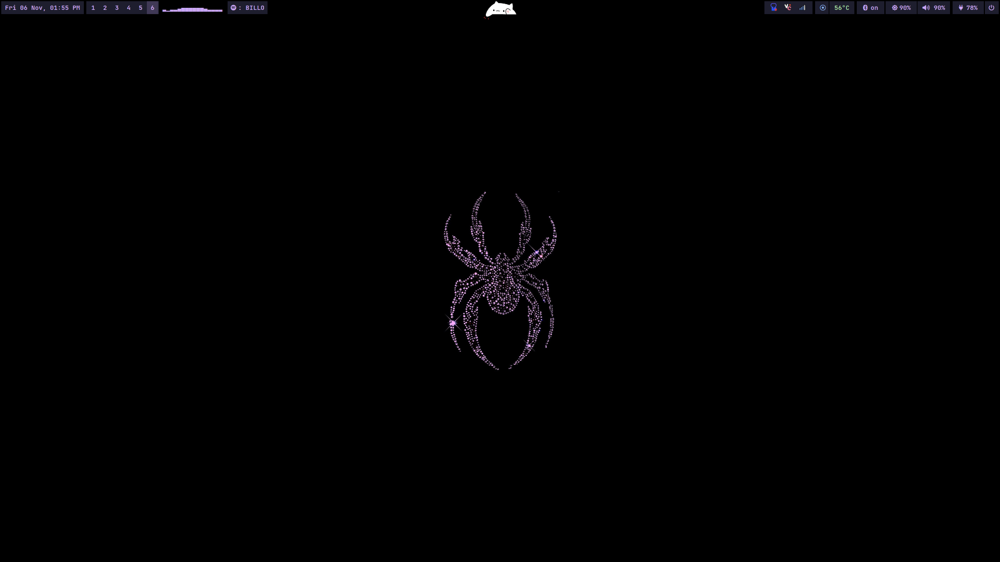
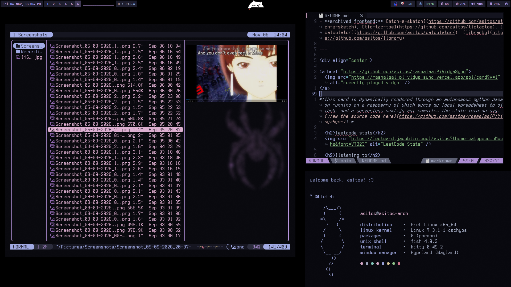

# dotfiles

my personal setup for arch linux + hyprland. i like keeping things fast, minimal, and out of the way so i can focus on writing code.

feel free to steal anything you like, but please don't blindly copy-paste my scripts unless you know what they do to your system :p

---

### the rice

> a quick look at the desktop environment.

<div align="center">
  

  
  <p><i>clean workspace</i></p>

  <br />
<video src="https://github.com/user-attachments/assets/dc0e6569-7e06-4245-a87e-38bcac709705" width="100%" controls></video>
  <p><i>hyprland animations and workflow</i></p>
</div>

> wallpaper can be found [here](https://github.com/user-attachments/assets/1c7ea0be-eb52-4327-9eea-1d4f35d7b180)

---

### things used

- **os:** arch linux
- **wm:** hyprland
- **terminal:** kitty
- **bar:** waybar & [bongocat](https://github.com/saatvik333/wayland-bongocat)
- **shell:** fish
- **notifs:** mako
- **clipboard:** clipse
- **editor:** [neovim](https://github.com/asitos/neovim-dotfiles)
- **launcher:** tofi
- **file manager:** yazi

---

### installation

there are two ways to install these dotfiles:

#### 1. automated symlink (install script)
runs [`install.sh`](./install.sh) to safely symlink configs into `~/.config/`. any existing configurations are automatically backed up with a timestamp. zero dependencies required — works on any linux distro:

```bash
git clone https://github.com/asitos/dotfiles.git
cd dotfiles
chmod +x install.sh
./install.sh
```

#### 2. manual (copy & paste)
if you don't want symlinks and just want specific configs, clone the repo and copy whichever folders you need directly into `~/.config/`:

```bash
git clone https://github.com/asitos/dotfiles.git
cd dotfiles

# copy individual tool:
cp -r config/<tool> ~/.config/

# or copy all configs:
cp -r config/* ~/.config/
```

> **neovim:** neovim config is maintained in its own repository at [asitos/neovim-dotfiles](https://github.com/asitos/neovim-dotfiles):
> ```bash
> # backup existing config if present
> [ -d ~/.config/nvim ] && mv ~/.config/nvim ~/.config/nvim.bak.$(date +%Y%m%d%H%M%S)
>
> # clone directly into ~/.config/nvim
> git clone https://github.com/asitos/neovim-dotfiles.git ~/.config/nvim
> ```

---

### uninstall

to remove the dotfiles symlinks and automatically restore your original configurations from backup:

```bash
cd ~/Projects/dotfiles
chmod +x uninstall.sh
./uninstall.sh
```

---

### arch linux full bootstrap (ansible)
for provisioning a fresh arch linux workstation (installs all system packages via pacman and sets up symlinks):

```bash
ansible-playbook -i ansible/inventory.ini ansible/setup.yml -K
```

---

### structure

```text
.
├── ansible/          # declarative provisioning & symlinking
├── config/           # tracked dotfiles (symlinked to ~/.config)
│   ├── bongocat
│   ├── btop
│   ├── clipse
│   ├── fish
│   ├── haj
│   ├── hypr
│   ├── kitty
│   ├── mako
│   ├── qBittorrent
│   ├── Scripts
│   ├── tofi
│   ├── waybar
│   └── yazi
├── install.sh        # automated symlink installer
├── uninstall.sh      # uninstaller & backup restorer
└── .github/          # CI linting & test workflows
```
